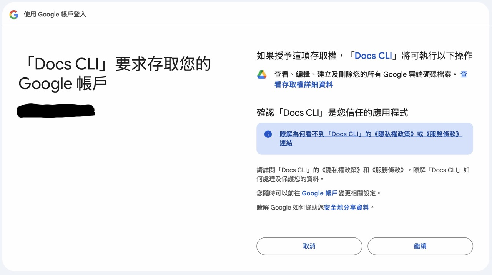
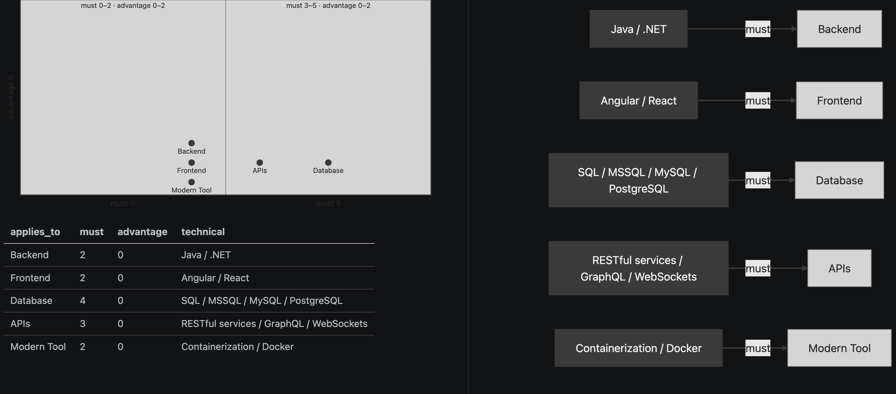

# jshelper

[](https://www.gnu.org/licenses/gpl-3.0)
[](https://go.dev/)
[](https://github.com/mark1688288/jshelper/releases/latest)

`docs-cli` helps us draft cover letters in a systematic workflow. It helps us quickly understand job ads. An LLM assists with `parse`, `analyze`, and `draft`. `draft` references the provided CV and cover letter templates, and an LLM drafts a cover letter for the provided job ad. It can upload parsed and analysis JSON files and create Google Docs in Google Drive.

## Prerequisites

- macOS 27 or later
- Apple silicon, M1 or later
- Go 1.27.1
- Google Cloud CLI (`gcloud`), logged in
- A Google account for the support email and the Testing test user
- An existing Google Drive folder; `create` and `upload` need `GOOGLE_DRIVE_FOLDER_ID`
- macOS Keychain for the refresh token; the first `auth` may prompt
- `fm` (`/usr/bin/fm`), with Apple Intelligence turned on
- A Gemini API Key

The full name of `fm` is the Apple Foundation Models command-line interface. It is preinstalled at `/usr/bin/fm` with macOS 27. Apple Foundation Models is the on-device language model behind Apple Intelligence, on a Mac with M1 or later.

## Quick Start

Download the Apple silicon release and install it into `/usr/local/bin`. That directory is already on the default macOS `PATH`, so the command is `docs-cli`.

The archive name is `docs-cli_darwin_arm64.tar.gz`. It contains the production `docs-cli` binary, `LICENSE`, `.env.example`, and `config/bootstrap.sh`. GitHub Releases serves it. A private repository only allows an account with access to download it.

```bash
curl -fL -o docs-cli_darwin_arm64.tar.gz https://github.com/mark1688288/jshelper/releases/latest/download/docs-cli_darwin_arm64.tar.gz
tar -xzf docs-cli_darwin_arm64.tar.gz
sudo install -m 755 docs-cli /usr/local/bin/docs-cli
```

If macOS blocks the installed command, clear the download quarantine:

```bash
xattr -d com.apple.quarantine /usr/local/bin/docs-cli
```

Run the commands below from the directory where you extracted the archive. That directory contains `.env.example` and `config/bootstrap.sh`. `docs-cli` reads `.env` from the current directory. `setup` copies `.env.example` to `.env` and runs `config/bootstrap.sh` there.

### Run wizard to setup

```bash
docs-cli setup
```

The first round copies `.env` when it is missing, asks `GCP_PROJECT_ID`, `GCP_PROJECT_NAME`, `GOOGLE_OAUTH_SUPPORT_EMAIL`, `GOOGLE_OAUTH_TEST_USER`, and `GOOGLE_DRIVE_FOLDER_ID`, creates the Cloud project when it is missing, and enables the Docs and Drive APIs.

In that same project, finish these Console pages by hand. Create a Desktop client. Leave Web and IAP clients unused.

Following urls will provided on screen

```bash
- Branding: `https://console.cloud.google.com/auth/branding?project=<GCP_PROJECT_ID>`
- Audience: External, Testing, and your test user. `https://console.cloud.google.com/auth/audience?project=<GCP_PROJECT_ID>`
- Data Access: add only `https://www.googleapis.com/auth/drive`. `https://console.cloud.google.com/auth/scopes?project=<GCP_PROJECT_ID>`
- Clients: Desktop app named `Docs CLI Desktop`. `https://console.cloud.google.com/auth/clients?project=<GCP_PROJECT_ID>`
```

> [!NOTE]
> Stay in Testing unless you are in a Google Workspace and can complete Google verification for this app.

```bash
docs-cli setup
docs-cli auth
```

The second `setup` asks for the client id and secret. `auth` stores the refresh token in the keyring. Sign in as the listed test user. The consent screen stays in Testing; an unlisted account gets `403: access_denied`.

Test the Google Drive connection by creating a Google Docs:

```bash
docs-cli create --title "Testing" --text "Hello world!"
```

## Security



The OAuth consent screen stays in Testing. Google expires that refresh token after about 7 days. When `create` fails with `invalid_grant`, run:

```bash
docs-cli auth
```

`docs-cli` stores the refresh token with [zalando/go-keyring](https://github.com/zalando/go-keyring) as Keychain item `docs-cli` / `refresh-token`. The payload is JSON with `refresh_token` and `scope`. Access tokens stay in memory.

That keyring item is the user grant. `credentials.json` is a different file: the Google installed Desktop client (`client_id`, `client_secret`, token URLs), derived from `.env`. Token exchange and refresh read the client id and secret from the env file. `setup` and `auth` rewrite `credentials.json` (mode `0600`) as that installed-app copy. The client secret stays in `.env` and `credentials.json`; it does not go in the keyring.

On macOS, go-keyring writes to Keychain. Keychain encrypts the item at rest and unlocks it with your login. The first `auth` may ask for permission.

> [!CAUTION] 
> Do not commit `.env`, `credentials.json`, `token.json`, `/design`, an OAuth client secret, or a personal `GOOGLE_DRIVE_FOLDER_ID`.

## Build

The release binary defaults to production when it is built with this link flag. Run it from the repository root, the directory that contains `.env.example`. A non-empty `APP_ENV` in the process environment overrides the compiled default.

```bash
go build -o docs-cli -ldflags "-X github.com/mark1688288/jshelper/internal/config.defaultAppEnv=production" ./cmd/docs-cli
```

## Google Gemini

When `docs-cli` calls Gemini, the model id is `GEMINI_MODEL` from `.env`. A missing or empty value uses the built-in model id. The API key is not read from `.env`.

`gemini-key` stores a Gemini API key in the keyring item `docs-cli` / `gemini-api-key`. The key is typed at the terminal and is not echoed. It is not a flag, not an environment variable, and it is not written to `.env` or `credentials.json`. `create`, `upload`, `auth`, and `setup` do not read or write that item.

```bash
docs-cli gemini-key
```

## Apple Intelligence

Apple Foundation Models command-line interface (we call it `on-device model` or `fm`) will be used in `docs-cli`, Apple Intelligence should turned on. A privileged user must already have run `sudo fm license`.

## Parse

`parse` reads a saved job HTML file and writes JSON. A JobsDB page still uses its job-detail fields. Another page uses the first schema.org JobPosting, or the page's paragraphs when that object is absent. `parse` sends only the extracted plain text, with email addresses removed to `fm`. 

```bash
docs-cli parse --html PATH [--autoparse]
docs-cli parse --txt PATH
docs-cli parse --batch
```

`parse --autoparse` sends that saved HTML to Gemini and writes the same section JSON. Email addresses are removed before the page is sent. `parse --txt PATH` reads a text file of the job details and sends that text to Gemini. Email addresses are removed before the text is sent. It does not need `--autoparse`. `parse --batch` reads every .txt file in `./batch/jobads`, one or more, and sends each file to Gemini. It writes the section JSON in `./batch/jobads/parsed` and moves that .txt file there. It creates `./batch`, `./batch/jobads`, and `./batch/jobads/parsed` when they are missing.

> [!NOTE] 
> The email addresses mentioned here include the user's email on the job recruitment website.

### Json Schema

```json
{
  "source": { "type": "string" },
  "header": {
    "title_block": { "type": "string" },
    "company": { "type": "string" },
    "location": { "type": "string" },
    "work_type": { "type": "string" },
    "classification": { "type": "string" }
  },
  "benefits": ["type": "array", "items": { "type": "string" } ],
  "duties": ["type": "array", "items": { "type": "string" } ],
  "requirements": ["type": "array", "items": { "type": "string" } ],
  "trailer": ["type": "array", "items": { "type": "string" } ]
}
```

## Analyze

`analyze` reads that section JSON and writes the requirement JSON to stdout. It supports one file, `analyze --json PATH`, or a batch, `analyze --batch`. By default it calls Apple `fm`. If `fm` is unavailable and a Gemini API key is already stored, it falls back to Gemini. `--gemini` bypasses the `fm` call.

`analyze --batch` reads every `.json` file in `./batch/jobads/parsed`, moves that file into `./batch/jobads/analyzed`, and writes the analysis files there. `parsed` must already exist. `analyzed` is created when it is missing.

```bash
docs-cli analyze --json PATH [--gemini]
docs-cli analyze --batch [--gemini]
```

> [!TIP] 
> Saves file to speicified location by 
> ```bash
> docs-cli analyze --json PATH > PATH
> ```

An empty requirements list exits 1 with `docs-cli: requirements is empty` and does not run `fm` or Gemini.

#### Folders structure of batch mode:

```bash
./batch/jobads/parsed/
./batch/jobads/analyzed/name.json
./batch/jobads/analyzed/name-analysis.json
./batch/jobads/analyzed/name-tech.md
./batch/jobads/analyzed/name-tech-dist.md
```



`analyze` creates the diagrams that help us quickly understand the job ad's technical requirements.

### Json Schema

```json
{
  "type": "object",
  "properties": {
    "must_have": { "type": "array", "items": { "type": "string" } },
    "advantage": { "type": "array", "items": { "type": "string" } },
    "min_years": { "type": ["integer", "null"] },
    "degree": { "type": ["string", "null"] },
    "languages": { "type": "array", "items": { "type": "string" } },
    "tech": {
      "type": "array",
      "items": {
        "type": "object",
        "properties": {
          "name": { "type": "string" },
          "level": { "type": "string" },
          "applies_to": { "type": ["string", "null"] }
        },
        "required": ["name", "level", "applies_to"]
      }
    },
    "soft_skills": { "type": "array", "items": { "type": "string" } }
  },
  "required": ["must_have", "advantage", "min_years", "degree", "languages", "tech", "soft_skills"]
}
```

## Draft

`draft` reads a cover-letter template PDF and the section JSON from `parse`, then writes a letter with `fm`. It also reads the CV or resume PDF named by `--cv`. The `fm` selects the skills, projects, and achievements in that CV that match the job, and drafts the letter from those facts. The letter covers that experience, interest in the employer and fit for the role, and a polite close with a call to action. The CV is not sent to Gemini. The `fm` drafts the whole letter from the job JSON and the template's structure. The letter is saved in a `drafts` directory in the working directory. That directory is created if it does not exist. Without `--pdf` it writes a timestamped .txt file in drafts. With `--pdf NAME` it writes a PDF instead.

```bash
docs-cli draft --json PATH --template PATH --cv PATH
docs-cli draft --json PATH --template PATH --cv PATH --pdf NAME.pdf
```

## Google Docs

`create` creates a Google Doc from our cover letter.

```bash
docs-cli create -title "MY Cover Letter" --import ./drafts/cover_letter.pdf
```

## Google Drive

`upload` backs up the JSON files we created with `parse` and `analyze`.

```bash
docs-cli upload parsed.json analysis.json
```

## Uninstall

```bash
rm -f docs-cli_darwin_arm64.tar.gz docs-cli LICENSE .env.example config/bootstrap.sh
security delete-generic-password -s docs-cli -a refresh-token
security delete-generic-password -s docs-cli -a gemini-api-key
```

## License

Copyright (C) 2026 mark1688288.

This program is free software under the GNU General Public License version 3 only. See [LICENSE](LICENSE).

If you distribute this program, or a modified version of it, including inside a commercial product, you must license that work under GPL-3.0 and make the corresponding source available. Using it yourself, without distributing it, does not require you to publish your changes.

## Credits

Refresh tokens are stored with [zalando/go-keyring](https://github.com/zalando/go-keyring). Copyright (c) 2016 Zalando SE.

Template and CV PDFs are read with [ledongthuc/pdf](https://github.com/ledongthuc/pdf). Copyright (c) 2009 The Go Authors.

Job-page HTML is parsed with [golang.org/x/net/html](https://pkg.go.dev/golang.org/x/net/html). Copyright 2009 The Go Authors.

The OAuth loopback uses [golang.org/x/oauth2](https://pkg.go.dev/golang.org/x/oauth2). Copyright 2009 The Go Authors.

Terminal checks and hidden secret input use [golang.org/x/term](https://pkg.go.dev/golang.org/x/term). Copyright 2009 The Go Authors.

Google Docs and Drive clients come from [google.golang.org/api](https://pkg.go.dev/google.golang.org/api). Copyright (c) 2011 Google Inc.
